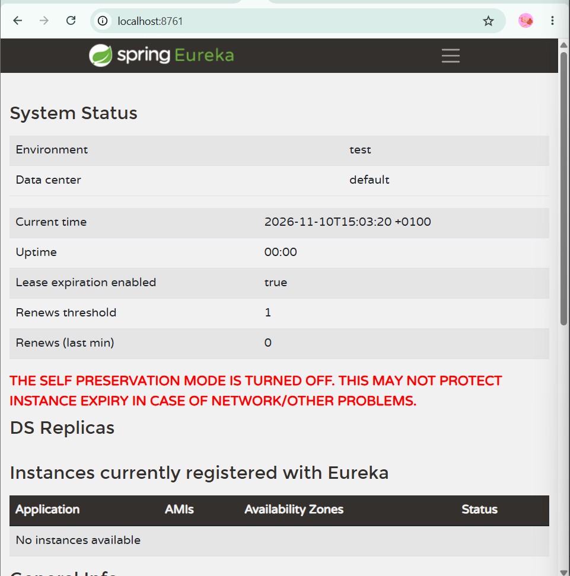
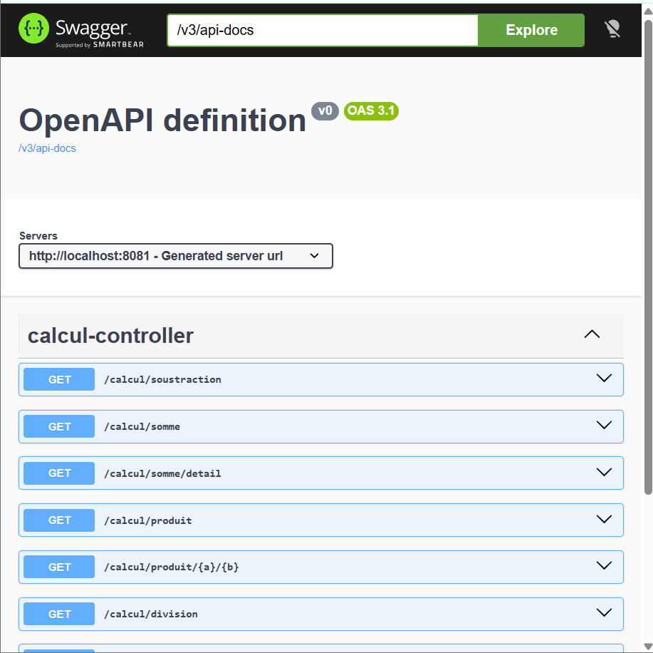
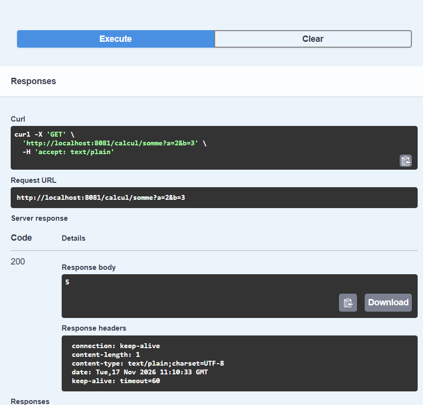
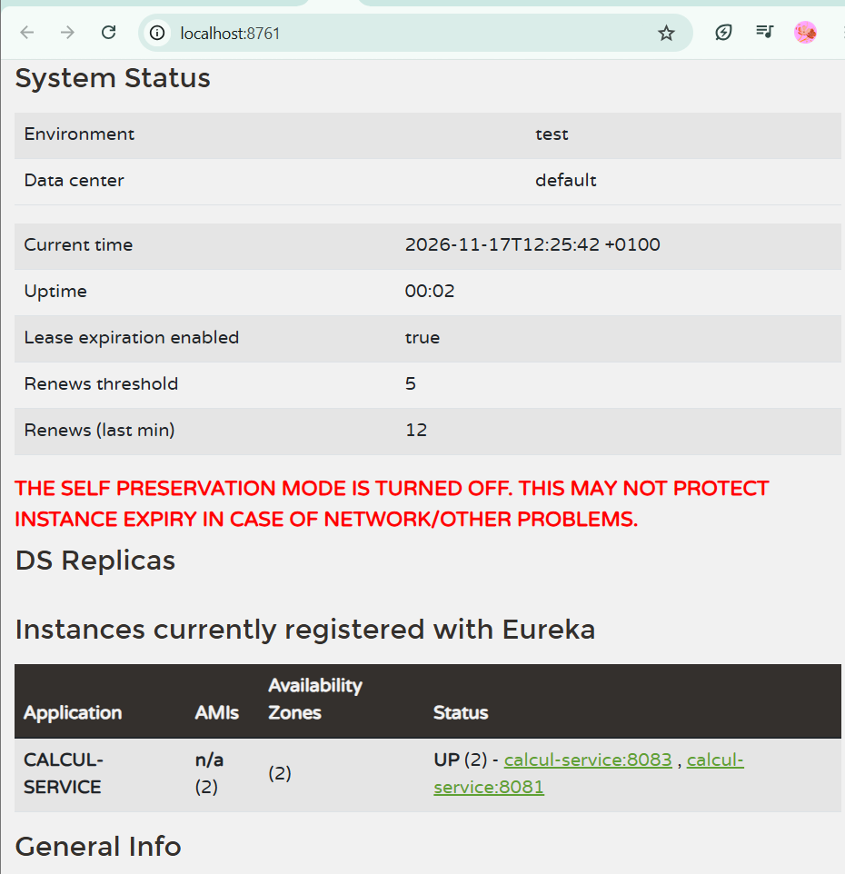
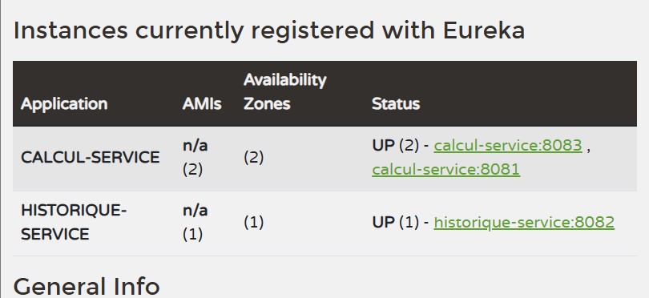
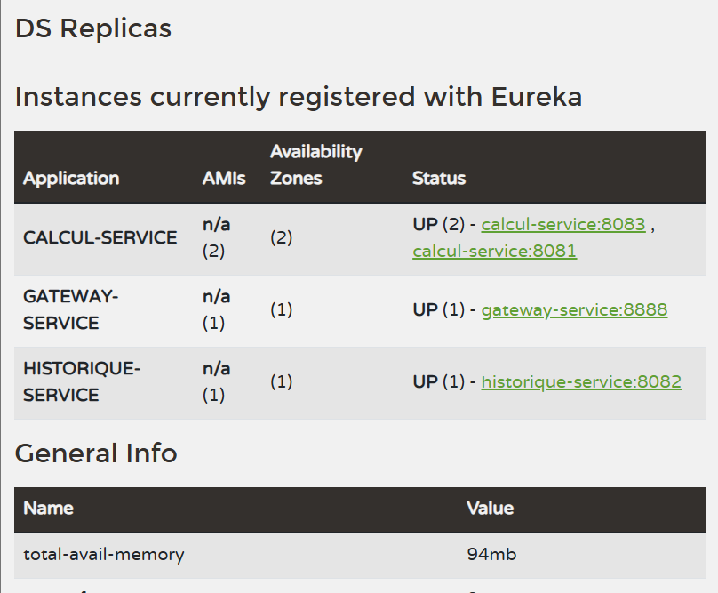
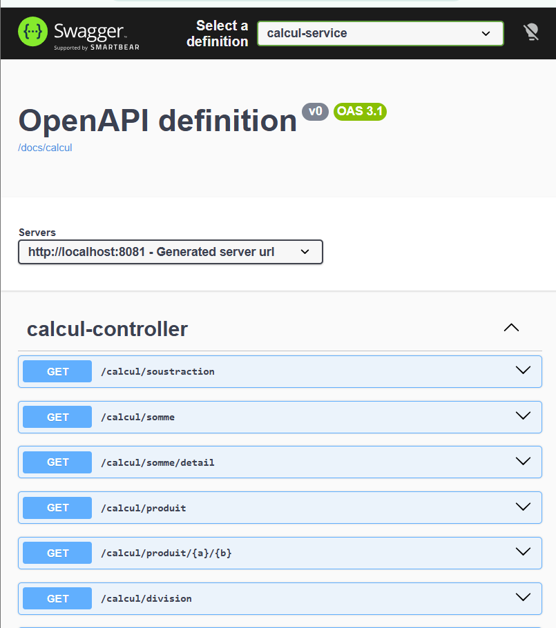

# TP4 Spring Cloud : Microservices « Calculatrice »
# Guerfel Nour

**Matière :** Architecture MicroServices, MPSRCC1
**Technologies :** Spring Boot 4.0.9, Spring Cloud 2025.1.2, Java 17, Eureka, OpenFeign, Spring Cloud Gateway, Swagger UI (springdoc 3.0.3), Lombok

## Présentation du projet

| Programme | Port | Rôle |
|---|---|---|
| eureka-service | 8761 | Annuaire des services (Eureka Server) |
| calcul-service (instance 1) | 8081 | Effectue les quatre calculs |
| calcul-service (instance 2) | 8083 | Second exemplaire (`--server.port=8083`) |
| historique-service | 8082 | Enregistre les opérations, appelle CALCUL-SERVICE par OpenFeign |
| gateway-service | 8888 | Passerelle : point d'entrée unique des clients |

```
calculatrice-spring-cloud/
|-- pom.xml                 (pom parent)
|-- eureka-service/
|-- calcul-service/
|-- historique-service/
|-- gateway-service/
|-- screenshots/
`-- README.md
```

Ordre de lancement : eureka-service, calcul-service (x2), historique-service, gateway-service.

---

## Partie A : Questions de conception

**Question 1.** Quel composant fait la correspondance entre le nom et les adresses ? Quand est-elle mise à jour ?

C'est l'annuaire Eureka. Chaque microservice s'y inscrit au démarrage sous son `spring.application.name`, envoie un battement de cœur régulier (toutes les 5 s dans ce TP) et se désinscrit à l'arrêt. Eureka retire aussi une instance qui ne donne plus de nouvelles. La liste est donc mise à jour à chaque inscription, désinscription ou éviction. Les clients gardent une copie locale, rafraîchie toutes les 5 s.

**Question 2.** Un avantage et un inconvénient du point d'entrée unique.

- Avantage : le client ne connaît qu'une adresse (8888), quel que soit le nombre de microservices.
- Inconvénient : si la passerelle tombe, plus rien n'est accessible. Elle peut aussi devenir un goulot d'étranglement.

**Question 3.** Six requêtes `GET /calcul/somme?a=1&b=1` avec deux instances.

Chaque instance reçoit 3 requêtes (tour de rôle : 8081, 8083, 8081, 8083, 8081, 8083). Le client ne s'en aperçoit pas : la réponse est toujours 2.

---

## Partie B : L'annuaire eureka-service

Au premier lancement, le tableau de bord (http://localhost:8761) indique « No instances available » : aucun service n'est encore inscrit. Le message rouge sur le mode auto-préservation est normal (`enable-self-preservation=false`).


**Question B.1.** Pourquoi Eureka peut-il tourner avec calcul-service et historique-service ?

Chaque programme est un processus Java indépendant avec son propre port : 8761, 8081, 8082. Il n'y a donc aucun conflit de port.

---

## Partie C : Enregistrer les microservices dans l'annuaire

Swagger UI de calcul-service (http://localhost:8081/swagger-ui.html) : la page liste les opérations de `calcul-controller`.



Test de `GET /calcul/somme?a=2&b=3` : code 200, réponse `5`.



Avec la seconde instance sur le port 8083, CALCUL-SERVICE affiche **UP (2)** : `calcul-service:8081` et `calcul-service:8083`.



**Question C.1.** Les deux instances ont le même nom mais des identifiants différents. À quoi sert chacun ?

Le nom (`CALCUL-SERVICE`) désigne le service : c'est lui qu'un appelant utilise pour demander les instances à l'annuaire. L'identifiant (`calcul-service:8081`, `calcul-service:8083`) désigne une instance précise : Eureka s'en sert pour suivre son battement de cœur et la retirer individuellement, et le répartiteur de charge pour en choisir une.

**Question C.2.** Que se passe-t-il sans `--server.port=8083` ?

La seconde instance essaie d'utiliser le port 8081, déjà pris par la première. Le démarrage échoue avec « Port 8081 was already in use ».

**Expérience C.6 (arrêt d'une instance).**

Arrêtée proprement (bouton Stop), l'instance prévient Eureka et disparaît tout de suite. Si le processus est tué brutalement, Eureka ne reçoit plus de battement de cœur et la retire après environ 10 secondes. Relancée, elle réapparaît dès son démarrage.

---

## Partie D : OpenFeign

historique-service appelle `CALCUL-SERVICE` par son nom grâce à l'interface `CalculClient` (`@FeignClient(name = "CALCUL-SERVICE")`). Le tableau de bord montre maintenant deux services : CALCUL-SERVICE UP (2) et HISTORIQUE-SERVICE UP (1).



**Question D.1.** Six fois la requête 1 : quelle instance répond ? Quelle règle ? Quel nom ?

Les requêtes alternent entre 8081 et 8083. La règle est : « prendre l'instance suivante de la liste, à tour de rôle ». Cette stratégie s'appelle le **round robin**.

**Question D.2.** Nom mal écrit (`CALCUL-SERVIC`).

On obtient **503 Service Unavailable** avec `{"erreur":"calcul-service injoignable"}`. Eureka ne connaît aucune instance de ce nom, donc Feign lève une `FeignException`. La réponse vient du second `catch (FeignException e)`. Le premier (`FeignException.BadRequest`) ne correspond qu'à un 400 envoyé par un service qui répond. Le bon nom a ensuite été remis.

### Résultats des tests D.4 (Swagger UI, port 8082)

| N° | Requête | Corps | Statut obtenu | Résultat |
|---|---|---|---|---|
| 1 | POST /operations | `{"operateur":"somme","a":8,"b":2}` | 201 | resultat 10.0, en-tête Location |
| 2 | POST /operations | `{"operateur":"produit","a":6,"b":7}` | 201 | resultat 42.0 |
| 3 | POST /operations | `{"operateur":"division","a":7,"b":2}` | 201 | resultat 3.5 |
| 4 | POST /operations | `{"operateur":"division","a":7,"b":0}` | 400 | « Erreur : division par 0 impossible » |
| 5 | POST /operations | `{"operateur":"racine","a":9,"b":0}` | 400 | « Operateur inconnu : racine » |
| 6 | GET /operations | aucun | 200 | les opérations 1, 2 et 3 |
| 7 | GET /operations/2 | aucun | 200 | opération produit, resultat 42.0 |

Les traces des requêtes 1 à 4 alternent entre les consoles `[calcul-service:8081]` et `[calcul-service:8083]`. La requête 5 ne produit aucune trace, car l'erreur est détectée avant l'appel à calcul-service.

---

## Partie E : La passerelle gateway-service

Avec la passerelle, le tableau de bord affiche trois services : CALCUL-SERVICE (2 instances), HISTORIQUE-SERVICE et GATEWAY-SERVICE.



Swagger UI de la passerelle (http://localhost:8888/swagger-ui.html) : la liste **Select a definition** propose `calcul-service` et `historique-service`.



**Question E.1.** Pourquoi `Location` indique-t-il le port 8888 et non 8082 ?

La passerelle ajoute les en-têtes `X-Forwarded-Host` et `X-Forwarded-Port` (et `X-Forwarded-Prefix` en configuration dynamique) à la requête transmise. Avec `server.forward-headers-strategy=framework`, historique-service les lit, et `ServletUriComponentsBuilder` construit l'URL avec l'adresse du client.

### E.2 : Routes statiques en YAML

Routes : `/calcul/**` vers `http://localhost:8081`, `/operations/**` vers `http://localhost:8082`, et deux routes `/docs/...` pour Swagger UI.

| N° | Requête (préfixe http://localhost:8888) | Statut | Réponse | Qui a répondu |
|---|---|---|---|---|
| 1 | GET /calcul/somme?a=2&b=3 | 200 | 5 | calcul-service 8081 |
| 2 | GET /calcul/division?a=7&b=0 | 400 | Erreur : division par 0 impossible | calcul-service 8081 |
| 3 | GET /operations | 200 | tableau des opérations | historique-service |
| 4 | POST /operations (soustraction 10-4) | 201 | resultat 6.0, Location avec port 8888 | historique-service puis calcul-service |
| 5 | GET /calcul/somme/detail?a=2&b=3 | 200 | `{"operation":"somme","a":2,"b":3,"resultat":5.0}` | calcul-service 8081 |
| 6 | GET /bonjour (navigateur) | 404 | erreur JSON de la passerelle | la passerelle (aucune route) |

Avec des adresses fixes, la trace sort toujours sur 8081 : l'instance 8083 est ignorée.

### E.3 : Routes `lb://`

Les adresses fixes sont remplacées par `lb://CALCUL-SERVICE` et `lb://HISTORIQUE-SERVICE`. La passerelle demande à Eureka les instances et les sollicite à tour de rôle : les traces alternent entre 8081 et 8083.

### E.4 : Routes en Java

Les mêmes routes sont déclarées dans un bean `RouteLocator`. Les deux formes sont équivalentes et donnent les mêmes résultats que E.2.

### E.5 : Routes dynamiques

Avec `discovery.locator.enabled: true`, la passerelle crée une route par service de l'annuaire. Le nom du service devient le premier segment de l'URL.

| N° | Requête (préfixe http://localhost:8888) | Statut | Réponse |
|---|---|---|---|
| 1 | GET /calcul-service/calcul/somme?a=2&b=3 | 200 | 5 |
| 2 | GET /calcul-service/calcul/produit/6/7 | 200 | 42 |
| 3 | GET /historique-service/operations | 200 | tableau des opérations |
| 4 | POST /historique-service/operations (somme 1+1) | 201 | resultat 2.0 |
| 5 | GET /calcul/somme?a=2&b=3 (navigateur) | 404 | plus de route `/calcul/**` |
| 6 | GET /gateway-service/actuator/gateway/routes | 200 | liste JSON des routes |

Quand on arrête historique-service et qu'on attend une dizaine de secondes, sa route disparaît de `/actuator/gateway/routes`. Quand on le relance, elle réapparaît : les routes suivent l'annuaire.

**Question E.2.** Comparez les URI de E.3 et E.5. Avantage de chaque forme ? Laquelle oblige à modifier la passerelle ?

- E.3 (statique) : `GET :8888/calcul/somme?a=2&b=3`. Les URI sont propres, le nom interne du service n'apparaît pas, et on garde la main sur chaque route (prédicats, filtres).
- E.5 (dynamique) : `GET :8888/calcul-service/calcul/somme?a=2&b=3`. Aucune route à écrire : un nouveau microservice inscrit dans Eureka est accessible tout de suite.
- La forme **statique** oblige à modifier la passerelle à chaque nouveau microservice.

**Question E.3.** Pourquoi la passerelle a-t-elle une route vers elle-même ? Est-ce gênant ?

La passerelle est elle-même inscrite dans Eureka (`GATEWAY-SERVICE`). Le mécanisme dynamique crée une route pour tous les services de l'annuaire, donc aussi pour elle. Ici ce n'est pas gênant : cela permet de consulter `/actuator/gateway/routes` par ce chemin. En production, il vaut mieux filtrer, car cette route expose des endpoints internes.

---

## Questions de synthèse

**1. Tableau A.3 : étape où chaque différence est observée.**

| Aspect | Étape |
|---|---|
| Nombre de programmes | B (annuaire), C.5 (2e instance), E.1 (passerelle) |
| Dépendances Maven | B.2, C.1, C.7, E.1 |
| Adresse d'un microservice | C.2, C.7, D.2 (le nom remplace l'adresse) |
| Appel entre microservices | D.2 (interface `CalculClient`) |
| Erreurs d'appel | D.3 et question D.2 (`FeignException`, 503) |
| Point d'entrée du client | E.2 (tout passe par 8888) |
| Plusieurs instances | C.5, D.4 et E.3 (traces qui alternent) |
| Serveur embarqué | B.5 (Tomcat), E.2 (Netty : « Netty started on port 8888 ») |
| Arrêt d'un microservice | C.6 |
| Organisation du code | B.0, C.0 |
| Outil de test | C.4, D.4, E.2 (Swagger UI) |
| Classes de données | C.1 bis, C.7 (Lombok) |

**2. Trajet de `POST :8888/historique-service/operations` (`{"operateur":"somme","a":1,"b":2}`).**

1. Le client envoie la requête à la passerelle (8888). **Requête HTTP 1.**
2. La route dynamique `/historique-service/**` correspond. La passerelle consulte sa copie locale de l'annuaire, son LoadBalancer choisit une instance de HISTORIQUE-SERVICE, elle retire le préfixe et ajoute les en-têtes `X-Forwarded-*` (dont `X-Forwarded-Prefix`). **Requête HTTP 2** : `POST /operations` vers 8082.
3. `OperationController` appelle `calculClient.calculer("somme", 1, 2)`. OpenFeign consulte la copie locale de l'annuaire, LoadBalancer choisit 8081 ou 8083. **Requête HTTP 3** : `GET /calcul/somme?a=1&b=2`.
4. calcul-service affiche sa trace et répond `3`.
5. historique-service range l'opération (3.0) et répond 201 avec `Location` construit à partir des `X-Forwarded-*`.
6. La réponse remonte : historique-service, passerelle, client.

Il y a 3 requêtes HTTP et 2 consultations de l'annuaire (passerelle, puis historique-service).

**3. Les trois programmes qui contiennent Spring Cloud LoadBalancer.**

Il est inclus avec le client Eureka :
- `historique-service` : résout `CALCUL-SERVICE`.
- `gateway-service` : résout `CALCUL-SERVICE` et `HISTORIQUE-SERVICE` (et en E.5 un nom par service de l'annuaire).
- `calcul-service` : il contient le répartiteur mais n'appelle personne, donc ne résout aucun nom.

**4. Client Eureka, OpenFeign, Gateway : où et pourquoi ?**

| Dépendance | calcul-service | historique-service | gateway-service |
|---|---|---|---|
| Client Eureka | Oui : s'inscrire | Oui : s'inscrire et trouver calcul-service | Oui : `lb://` et routes dynamiques |
| OpenFeign | Non : n'appelle personne | Oui : appelle calcul-service par son nom | Non : la passerelle utilise des routes |
| Gateway | Non | Non | Oui : c'est le point d'entrée |

**5. Problème de l'adresse écrite en dur.**

Avec `calcul.service.url=http://localhost:8081`, historique-service ne connaît qu'une instance. Si on en lance trois, les deux autres ne reçoivent rien : pas de répartition de charge. Si l'adresse change, il faut modifier la configuration et relancer. Ce TP le résout avec :
- **Eureka Server** : liste à jour de toutes les instances.
- **Client Eureka** : chaque service s'inscrit et trouve les autres.
- **OpenFeign** : l'appel se fait par le nom `CALCUL-SERVICE`.
- **Spring Cloud LoadBalancer** : choisit une instance à chaque appel, à tour de rôle.
- **Spring Cloud Gateway** : point d'entrée unique, qui répartit aussi la charge avec `lb://`.

**6. Deux instances d'historique-service (8082 et 8084).**

Les trois POST sont répartis entre les deux instances (par exemple 2 et 1). Chaque instance a sa propre mémoire, donc `GET /historique-service/operations` ne renvoie que la liste de l'instance qui répond, et le résultat change d'un appel à l'autre. Les identifiants peuvent aussi se répéter. Le principe mis en défaut est celui de **service sans état** (stateless). On le corrige avec une base de données (ou un cache) partagée par toutes les instances.

**7. Construire et lancer sans IntelliJ.**

À la racine, une commande construit les quatre modules :

```
mvn clean package -DskipTests
```

Puis, dans cinq terminaux, dans cet ordre :

```
java -jar eureka-service/target/eureka-service-0.0.1-SNAPSHOT.jar
java -jar calcul-service/target/calcul-service-0.0.1-SNAPSHOT.jar
java -jar calcul-service/target/calcul-service-0.0.1-SNAPSHOT.jar --server.port=8083
java -jar historique-service/target/historique-service-0.0.1-SNAPSHOT.jar
java -jar gateway-service/target/gateway-service-0.0.1-SNAPSHOT.jar
```

**8. Rôle de `@GetMapping("/calcul/{operateur}")`.**

Dans `CalculController`, elle décrit la requête **reçue** : Spring exécute la méthode quand un `GET /calcul/...` arrive. Dans `CalculClient`, elle décrit la requête **envoyée** : OpenFeign construit le `GET` et l'envoie à une instance de CALCUL-SERVICE. Même annotation, lue dans l'autre sens.

**9. Le regroupement en modules remet-il en cause l'indépendance ?**

Non. Chaque microservice garde sa propre JVM, son propre port, son propre `.jar` (construit depuis son `pom.xml`) et son propre cycle de vie : on peut le lancer, l'arrêter ou le redéployer sans toucher aux autres (voir C.6).

**10. Origine de l'adresse de la zone Servers.**

Elle vient des en-têtes `X-Forwarded-Host`, `X-Forwarded-Port` et `X-Forwarded-Prefix` ajoutés par la passerelle : `http://localhost:8888` en E.2, `http://localhost:8888/calcul-service` en E.5. Sans `server.forward-headers-strategy=framework`, le microservice ignore ces en-têtes et annonce sa propre adresse (par exemple `http://localhost:8081`). Le Execute contournerait alors la passerelle, et pourrait échouer (CORS).

**11. Où sont les méthodes générées par Lombok ?**

Dans le fichier compilé (par exemple `target/classes/com/example/historique/model/Operation.class`), pas dans le code source. Lombok est un processeur d'annotations : il ajoute les constructeurs, getters et setters au bytecode à la compilation. Une fois le `.class` produit, Lombok n'est plus nécessaire à l'exécution, donc on peut l'exclure du `.jar`.
